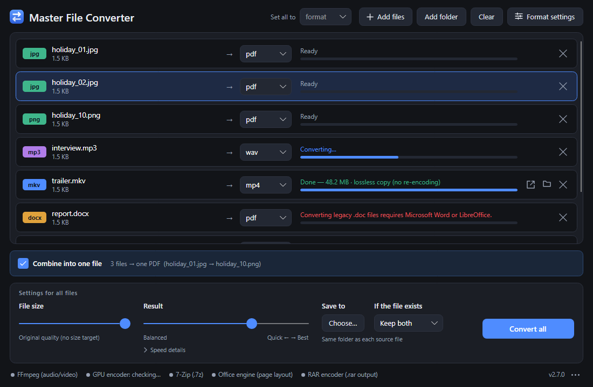

<h1 align="center">
  <br>
  Master File Converter
</h1>

<h3 align="center">
  <a href="https://github.com/ZeronTwoi/MasterFileConverter/releases/latest">Download the latest version</a>
</h3>

<p align="center">Windows 10 / 11 and Linux · free · works offline</p>

A fast desktop app that converts images, audio, video, documents and archives. Drop files in,
pick a format, press Convert.



## Download and start

On the [download page](https://github.com/ZeronTwoi/MasterFileConverter/releases/latest), under
**Assets**, take the file for your system:

| System | File | Then |
|---|---|---|
| Windows 10 / 11 | the one ending in `win-x64-setup.exe` | run it — no administrator rights needed |
| Windows, without installing | the one ending in `win-x64.zip` | unzip anywhere and run `MasterFileConverter.exe` |
| Linux (64-bit) | the one ending in `linux-x64.tar.gz` | unpack, then run `./install.sh` — or `./masterfileconverter` without installing |

Nothing else has to be installed first. The first time, Windows may say "Windows protected your
PC", because the app is not code-signed yet: choose **More info**, then **Run anyway**.

At its first start the app offers to fetch FFmpeg and 7-Zip (for audio, video and .7z) from their
publishers, and checks what it downloaded against their checksums. Everything else is built in.

**Updating** takes one click in the app when a new version is out. **Uninstalling** removes all
of it — the app, its shortcuts, the engines it downloaded and, unless you keep them, your
settings: on Windows under *Settings → Apps → Installed apps*, on Linux with
`masterfileconverter --uninstall`.

## What it converts

| | From | To |
|---|---|---|
| Images | jpg, png, gif, webp, bmp, tiff, heic, ico | jpg, png, gif, webp, bmp, tiff, pdf |
| Audio | mp3, wav, flac, aac, ogg, m4a, wma, opus | mp3, wav, flac, aac, m4a, ogg, opus |
| Video | mp4, mkv, avi, webm, mov, wmv, flv, ts, m4v | mp4, mkv, avi, webm, mov, gif, audio only, picture frames |
| Documents | txt, pdf, doc, docx, md, log | txt, pdf, doc, docx, pdf pages as pictures |
| Archives | zip, 7z, rar, tar, gz, bz2 | zip, 7z, tar (rar when WinRAR or `rar` is installed) |

## What it does well

- **Keeps the quality.** At 100 % nothing is thrown away that the target format can keep: video
  and audio are copied instead of re-encoded wherever the format allows, pictures stay
  pixel-exact or lossless.
- **Whole batches at once.** Many pictures become one PDF, GIF or multi-page TIFF; many files
  one archive; a PDF or a video becomes its pages or frames.
- **Fast.** Every processor core is used, and the graphics card for video where that is
  actually quicker.
- **Simple, precise when wanted.** One slider trades size for quality. The *Detailed settings*
  panel gives exact control: resolution, bitrate, codec, target size, password and more.
- **Offline, and nothing behind your back.** Your files never leave your computer. The app
  only goes online for what you agree to: fetching the engines, one look per start for a newer
  version if you say yes when it asks, and installing that version when you click. No account,
  no ads, no usage data, nothing running in the background, nothing started with the system.
- **A command line** for scripts, in the same download.

All the details — every setting, what "lossless" covers, speed measurements, the command line,
what has been tested — are in [docs/details.md](docs/details.md).

## Build it yourself

With the [.NET 10 SDK](https://dotnet.microsoft.com/download):

```powershell
dotnet run --project FileConverter     # run the app
dotnet test FileConverter.Tests        # run the tests
build\publish.ps1                      # make the downloads (build/publish.sh on Linux)
```

## Licence

Master File Converter is open source under the [MIT License](LICENSE): free to use, change and
pass on, commercially too. The files you convert with it are yours, without conditions.

It is built with these libraries, whose licences ship in every download (the app's ··· menu →
*Licences*) and are listed in full in [THIRD-PARTY-NOTICES.md](THIRD-PARTY-NOTICES.md):

| Library | Licence |
|---|---|
| .NET, Avalonia, SkiaSharp, HarfBuzzSharp, .NET Community Toolkit, Open XML SDK, SharpCompress | MIT |
| Skia, ANGLE, PDFium | BSD 3-Clause |
| Magick.NET, PdfPig, qpdf | Apache 2.0 |
| ImageMagick and the image libraries built into it | ImageMagick License; LGPL for libheif, libde265 and libraw |
| QuestPDF | QuestPDF Community License |
| Inter and Lato (fonts) | SIL Open Font License 1.1 |

FFmpeg (GPL) and 7-Zip (LGPL) are not part of the download; the app fetches them from their
publishers when asked to, or uses the ones already installed.
