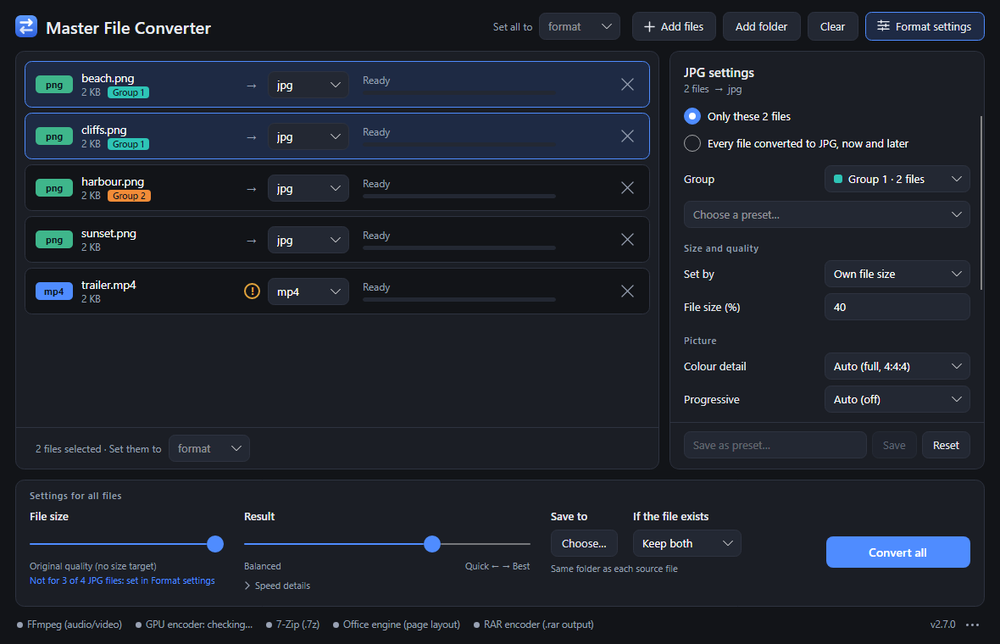
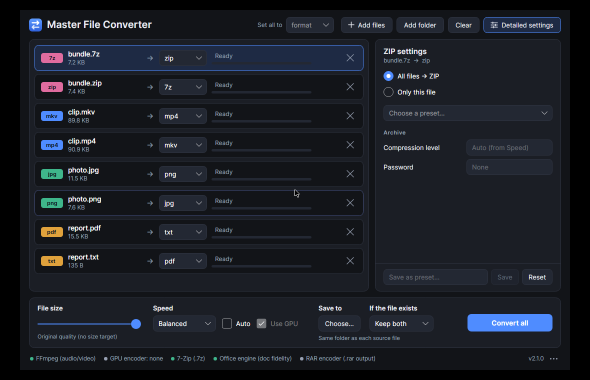

# Master File Converter in detail

What the [front page](../README.md) says in a few lines, in full: what is in the downloads, every
setting, what "lossless" covers, measured speed, the command line, how to build it, and what has
been tested.



## The downloads

Each contains only its own system's parts and its own copy of .NET — nothing to install first:

| System | File | Size | Start it |
|---|---|---|---|
| Windows 10 / 11 (64-bit), installer | `MasterFileConverter-<version>-win-x64-setup.exe` | 55 MB | run it |
| Windows 10 / 11 (64-bit), folder | `MasterFileConverter-<version>-win-x64.zip` | 74 MB (176 MB unpacked) | unzip, run `MasterFileConverter.exe` |
| Linux (64-bit, glibc) | `MasterFileConverter-<version>-linux-x64.tar.gz` | 81 MB (198 MB unpacked) | unpack, run `./install.sh` or `./masterfileconverter` |

The Windows downloads have no Linux code or libraries in them and the Linux download no Windows
ones: the windowing backend (Win32 / X11), the platform code and every native library are
chosen per system when the download is built.

**The Windows installer** installs for the current user only (no administrator rights), by
default into `%LOCALAPPDATA%\Programs\Master File Converter`. Its first page says what it puts
on the computer and what not; the next ones show the licence and ask where to install and what
to add — each a choice: a Start menu shortcut, a desktop shortcut, an entry in the "Send to" menu
(which hands a selection of files to one window), and the app under "Open with" for the file
types it reads, without making it the default for any. At the end it offers to start the app.
It always adds an entry under "Installed apps" with an uninstaller. It follows Windows' light or
dark mode, and an update remembers the choices made before. If the app is open, the installer
says so and closes it before replacing it. It installs nothing else: no other program, no
service, nothing that starts with Windows.

**Uninstalling** (*Settings → Apps → Installed apps*, or the same list in the Control Panel)
removes everything the installer and the app put on the computer: the program folder, the
shortcuts it made and a pin on the taskbar, its entries in the registry ("Installed apps",
"Open with", the name Win+R finds it by), the data folder with the downloaded engines, what was
measured about the PC, logs and a fetched update, and work files in the temp folder. It asks one
thing — whether the settings and saved presets should go too or stay for a later installation;
run without questions (`unins000.exe /VERYSILENT`) it removes them, unless `/KEEPSETTINGS` is
given. If the app is still open it asks for it to be closed first, since a running program's
files could not be removed. What Windows itself notes about any program — that it was used, or
chosen once under "Open with" — is Windows' own and stays.

An unpacked folder shows only what you start — `MasterFileConverter.exe` (and
`MasterFileConverter-cli.exe` for scripts, see [Command line](#command-line)) on Windows,
`masterfileconverter` and `install.sh` on Linux. Everything the program is made of lies in the
`app` folder beside it; keep the two together.

On Linux, `./install.sh` installs for the current user only (no root): the app goes to
`~/.local/lib/masterfileconverter`, a `masterfileconverter` command to `~/.local/bin`, and an
entry with the app's icon to the applications menu (so files can be opened with it).
`masterfileconverter --uninstall` (or `install.sh --remove` in that folder) takes all of it out
again, with the engines the app downloaded (`~/.local/share/masterfileconverter`), its settings
(`~/.config/masterfileconverter`) and work files left in the temp folder; add `--keep-settings`
to leave the settings for a later installation. A copy that was only unpacked is removed by
deleting its folder. The app needs what any desktop system has — an X server (or XWayland),
fontconfig and glibc; it does not need the ICU libraries.

The programs are not code-signed, so Windows shows its "Windows protected your PC" notice for a
freshly downloaded copy (**More info → Run anyway**).

The first start offers to download the conversion engines (see
[Conversion engines](#conversion-engines)). On Linux an installed `ffmpeg` (version 9 or newer)
and `7zz`/`7z` are used when they are there.

## Supported conversions

| Category  | Inputs                                              | Outputs                                   |
|-----------|-----------------------------------------------------|-------------------------------------------|
| Images    | jpg/jpeg, png, gif, webp, bmp, tif/tiff, heic, ico, svg | jpg, png, gif, webp, bmp, tiff, pdf    |
| Audio     | mp3, wav, flac, aac, ogg, m4a, wma, opus            | mp3, wav, flac, aac, m4a, ogg, opus        |
| Video     | mp4, mkv, avi, webm, mov, wmv, flv, ts, m4v         | mp4, mkv, avi, webm, mov + audio extract + gif + png/jpg frames |
| Text documents | docx, doc, odt, rtf, html/htm, md, epub, txt, log | pdf, docx, odt, rtf, html, md, epub, txt, doc + png/jpg pages |
| Spreadsheets | xlsx, xls, ods, csv                              | pdf, xlsx, ods, csv, html + png/jpg pages  |
| Presentations | pptx, ppt, odp                                  | pdf, pptx, odp + png/jpg slides            |
| PDF       | pdf                                                 | docx, doc, odt, rtf, html, md, epub, txt · xlsx, ods, csv · pptx, odp · png, jpg, tiff, svg |
| Drawings (through LibreOffice) | odg, pub                       | pdf + png/jpg pages                        |
| Archives  | zip, 7z, rar, tar, gz/tgz, bz2                      | zip, 7z, tar (+ rar when the RAR encoder is installed) |

Animated GIFs stay animated (gif ↔ webp, gif ↔ mp4/mkv/webm), and any file can be
packed into a zip/7z. The old binary Office formats — .doc, .xls, .ppt — are read; of the three
only .doc is also written.

## Documents: who converts what

There are two ways from one document format to another, and the app takes the better one for
each conversion by itself.

**An office program keeps the page.** Microsoft Word, Excel and PowerPoint (Windows) and
LibreOffice (both systems) lay a document out exactly as it is — fonts, columns, headers,
charts, a slide's design — so whenever both ends are formats such a program reads and writes,
it is asked first: Word and OpenDocument text and RTF among each other and into PDF;
workbooks among each other and into PDF as they would print; presentations among each other
and into PDF. The old .doc and .ppt, OpenDocument drawings (.odg) and Publisher files (.pub)
can only be read this way.

**The built-in converter keeps the content, and needs nothing installed.** It reads a document
into what it says and how it is built — headings, paragraphs with bold, italic, underline and
links, lists inside lists, tables, pictures, footnotes, page breaks — and writes that in the
target format: a Word file with real heading styles and real lists, a web page that carries its
pictures inside it, an e-book with a chapter per top-level heading and a table of contents,
Markdown as GitHub reads it (a document with pictures becomes a folder: the text, and an
`images` folder it refers to). It is the only way for Markdown, HTML and e-books, and stands in
for everything else wherever no office program is there:

- **A spreadsheet** becomes a PDF as a grid of its cells — numbers to the right, columns as
  wide as their content, a wide sheet turned to landscape and one too wide even for that
  continued with its remaining columns on further pages. Between Excel, ODS and CSV, a number
  stays a number and a date a date, each with its format; merged cells stay merged. CSV is read
  whatever it is separated by (comma, semicolon, tab) and whatever its encoding; a code with
  leading zeros stays the text it is.
- **A presentation** becomes a PDF with a page per slide, of the slide's size, every text box,
  picture and table where it stands; text too long for its box is made smaller, not cut off.
  What a slide inherits from its layout and master — where its title stands, the size of its
  type, its bullets — is looked up there. The theme's colours and backgrounds are an office
  program's to draw.
- **HTML** is read as a document, not rendered as a browser would: its headings, text, lists,
  tables and pictures, not the layout its style sheets arrange. Pictures come from the file
  itself or from its own folder; nothing is ever fetched from the internet.

**Out of a PDF**, which has no paragraphs or tables, only letters at positions:

- **into Word and the other text formats:** letters are grouped into words, lines and blocks; a
  short block in clearly larger type is a heading, bold and italic come from the fonts,
  pictures are put where they stood, page numbers and the lines repeated at the top and bottom
  of every page are left out, a paragraph that ran over a page end is joined again. (Word, where
  installed, is asked first for PDF → Word: it reflows the page layout too.) A scanned page is a
  picture of text, and comes out as that picture.
- **into Excel, ODS, CSV:** rows and columns are found again from where the words stand — a
  wide gap in a line divides two cells, and the table's complete rows say which cell is which
  column, wherever in its column it stands. Everything that is not a table goes into the first
  column, a line per row. Numbers become numbers when the document shows how it writes them
  (1,234.50 or 1.234,50); a number that could be read both ways stays text.
- **into PowerPoint or ODP:** every page becomes a slide of the page's size that shows it
  exactly — drawn by PDFium at 200 dpi and stored without loss. Its text is part of the
  picture. (LibreOffice's import, which gives text that can be edited and a look that is close
  rather than exact, can be chosen under Format settings.)
- **into SVG:** a page as a drawing — see below.

## Quality: what 100 % means

At the 100 % slider position nothing is thrown away that the target format can keep:

- **Video is copied, not re-encoded, whenever the target container can hold it.**
  mp4 ↔ mkv ↔ mov (H.264/HEVC), webm → mkv, and so on are re-wrapped bit-for-bit — instant
  and lossless — and so is any audio track the container accepts. Every audio track and
  text subtitle track is carried over. The file list says so: *"lossless copy"*.
- **When video does have to be re-encoded**, it uses a constant-quality target that was
  matched by measurement (PSNR against the source) to be visually lossless on every
  speed preset, at roughly the source's own file size. HDR sources stay 10-bit HEVC/VP9
  with their colour tags; targets that can only hold 8-bit SDR are tone-mapped instead of
  coming out grey.
- **Video → GIF** keeps up to 960 px and 30 fps (GIF stores frames nearly uncompressed —
  a 20 s 1080p clip would be ~400 MB at full size).
- **Audio extraction copies the stream** when it is already in the target format
  (mp4 → aac, mkv → mp3/flac …). wav/flac keep the source bit depth (24-bit stays
  24-bit, float stays float); lossy targets use transparent settings (mp3 V0, aac 256k).
- **Images**: 16 bits per channel internally, so deep-colour PNG/TIFF/HEIC sources aren't
  cut to 8 bits. PNG/BMP/TIFF targets are pixel-exact; WebP is *lossless* when the source
  was (png, bmp, tiff, gif); JPEG uses quality 97 with full-resolution colour (4:4:4).
  EXIF rotation is baked into the pixels, CMYK and wide-gamut pictures are converted
  through their ICC profiles when the target can't carry one, and an `.ico` yields its
  largest image rather than its 16-pixel thumbnail.
- **Images → PDF** take a JPEG or PNG as the very data it already is — nothing is decoded or
  compressed again, so nothing can be lost and it takes no time. **PDF → images** renders at
  300 dpi; **PDF → TIFF** puts every page into one file, compressed without loss, a page
  without colour stored as grey.
- **SVG → pictures** draws the drawing at 300 dpi (or the resolution set) — at that size, not
  drawn small and enlarged — and leaves transparent what it leaves empty. **SVG → PDF** keeps
  it a drawing: lines and letters in the PDF, sharp at any size.
- **PDF → SVG** writes a page as what it is made of: a shape as a path with its fill, outline,
  dashes and clip; a letter as its outline, taken from the font inside the PDF, so the text
  looks as it does in the PDF on any computer (it is a drawing of the text: it cannot be
  selected); a picture at its own resolution — a photo as the very JPEG that lies in the PDF.
  What cannot be said that way — a gradient, an object blended with what is under it — is drawn
  by PDFium by itself and placed as a small picture in the same spot and layer; filled-in form
  fields go on top the same way.
- **A document's pictures** travel as they are: a JPEG or PNG inside a Word file, an e-book or a
  web page goes into the result as the same data, never compressed a second time.
- **Text files** are read in their real encoding (UTF-8, UTF-16, or the legacy code page that
  goes with the system's language, such as Windows-1254), so accented letters survive.

Below 100 % the size slider takes over and trades quality for a target size.

## Settings for all files, and Format settings

Settings live in two places, and nothing can be set in both:

- **Settings for all files** — the bar at the bottom — are used for every file in the list,
  whatever its format: the **File size** slider (how small the results are made), the
  **Result** slider (how much care goes into each file), where results are saved, and what
  happens when a result's name is taken.
- **Format settings** — the button at the top — open a panel beside the file list with what only
  the selected file's target format has: a resolution, a video or audio format, pages, a paper
  size, a password and so on. It is off by default; with it off, and for anything left empty,
  the app decides exactly as described above.

Size and quality are the one thing the two could both decide, so in the panel they are a choice:
**Set by** the *File size slider* (the default), or for this format — or the files selected —
alone an *own file size* (a percentage, like the slider's), a *fixed quality*, a *fixed bitrate*
or an *exact file size* (for WebP also *lossless*; for archives a *fixed level*). Only the box
for the way chosen is shown, so they never compete, and choosing one clears the others. Under
the slider the bar says which files it does not decide ("Not for MP4, 2 of 5 JPG files: set in
Format settings").

**The Result slider** is the speed setting in plain words: from *Quick* (done soonest, files a
little larger) to *Best* (the best result for its size, takes longest). At 100 % File size no
position makes a file look worse — speed only trades time against how small a file can be made
at the same look; below 100 % the slower end also looks better at the same size. *Speed
details*, folded away under it, hold the same choice under the encoders' names (Fastest, Fast,
Balanced, Best quality), **Auto** (choose it for this PC — moving the slider chooses by hand
instead) and **Use GPU**.

- **What can be set depends on both ends of the conversion.** PDF → JPG has a resolution and a
  page list, video → JPG a frame rate, photo → JPG neither.
- **What is selected is what is set.** The panel opens on *Only this file* (or *Only these
  files*): the settings are the selected files' own, and whatever is left empty there follows
  the format. **For every file of a format** — "everything I turn into MP4", the files in the
  list and the ones added later — choose *Every file converted to MP4, now and later*; those
  settings are remembered for next time, and every file they apply to says so with a plain
  *MP4 settings* mark (a click on it shows them).
- **Several files at once.** Shift-click selects a range of rows, Ctrl-click adds a row or takes
  it away again, and either key held while dragging over rows with the left button down does
  the same to every row passed over. Files converted the same way (mov → mp4 and mkv → mp4, say)
  are then set together; a value they do not share shows as "Not the same in all". Files that
  become different formats can first be set to one with *Set them to* under the list.
- **Groups.** Files given the same settings of their own carry the same coloured *Group* tag in
  the list; its tooltip says what the group's settings are, and a click on it selects the whole
  group. Give some of them other settings and they become another group, in another colour. A
  group keeps its number and colour as long as it is there, and a file's own settings stay with
  the format they were made for: set to another format and back, it finds them again. The
  panel's *Group* list puts the files selected in a group of files converted the same way, or
  in none (no settings of their own). Files added later are in no group.
- **Presets** fill in a whole set at once ("Fit in 10 MB", "Web · 1920 px", "Podcast · mono
  64 kbps" …), and the current settings can be saved as a preset of your own.
- **Honest about lossless.** When a setting means the video or audio is encoded again instead of
  copied, the panel says so.

**The same format, only compressed.** A picture (JPG, PNG, GIF, WebP, BMP, TIFF), a sound, a
video, a zip, a 7z or a rar (where WinRAR is installed) can be set to its own format: it is then
not converted, only made smaller by the File size slider or its format settings. Such a row
shows a (!) instead of the arrow. A file set to its own format is never combined with others;
its result gets a name of its own (`photo (1).jpg`), so the source is never replaced; and when
nothing but its size was asked for and it cannot be made smaller — a JPEG saved again at top
quality usually grows — it is kept exactly as it was. (PDFs and documents cannot: there is no
PDF rewriter here, and a document has nothing to compress.)

| Result | Settings |
|---|---|
| Pictures | size and quality (JPG, WebP): the slider, a fixed quality, a size in KB, or lossless (WebP) · colour detail 4:4:4 / 4:2:2 / 4:2:0 · progressive · compression (TIFF) · maximum width / height · scale % · photo information: keep, remove location only, remove all · background colour for transparency · colours (GIF) |
| Video | size and quality: the slider, a fixed quality (CRF), a fixed bitrate or a size in MB · format: H.264, H.265, VP9, AV1 (where the installed FFmpeg can encode it) · maximum width / height · maximum frame rate · audio format, bitrate, channels, or no audio · subtitles · tags and chapters |
| Audio | size and quality (MP3, AAC, M4A, Ogg, Opus): the slider, a fixed quality (variable bitrate; MP3, Ogg), a fixed bitrate or a size in MB · sample rate · channels · bit depth (WAV, FLAC) · tags and cover art |
| GIF from video / pictures | frame rate · width · colours · shading · repeat · seconds per picture |
| Frames from video | frames per second · maximum number of frames · JPEG quality · maximum size |
| PDF or any document → images | resolution (dpi) · pages (`1-3, 7, 10-`) · plus the picture settings |
| SVG → pictures | resolution (dpi) · maximum width / height · plus the picture settings |
| Pictures → PDF | paper size · margins |
| Text, Markdown, HTML, e-book, CSV → PDF | paper size · margins · text size |
| Documents, spreadsheets, presentations | which engine converts: LibreOffice, Microsoft Office, or the built-in one |
| PDF → Excel / ODS / CSV | a sheet for every page, or all pages on one |
| … → CSV | separator: comma, semicolon or tab |
| PDF → PowerPoint / ODP | exact (pages as pictures) or LibreOffice's editable import · resolution (dpi) · pages |
| PDF → TIFF / SVG | pages (· resolution and compression for TIFF) |
| Archives | compression: Speed and the slider, or a fixed level 0–9 · password (AES-256; kept for the session, never saved) · solid 7z |

How hard PNG and FLAC compress, and how fast video is encoded, are Speed's to decide, so the
panel has no second control for them; a script can still set them (`--set compression=…`,
`--set speed=…`).

## Speed

- **One job per core.** Most conversions (an image, an mp3, a stream copy) are
  single-threaded inside, so a batch runs as many of them side by side as the CPU has
  threads (bounded by RAM for images).
- **One big job on every core.** What is a single file is divided where its format allows:
  the pages of a PDF are drawn by several copies of the program at once, a video becomes a GIF
  in stretches that are joined afterwards, a zip is compressed in pieces and a multi-page TIFF
  page by page — each with the same result as doing it in one go.
- **Nothing done twice.** A picture that has to fit a size is found in about four encodes
  instead of seven, a picture that only gets smaller is resampled once (and a JPEG is decoded
  at a fraction of its size to begin with), a file that cannot be compressed goes into a zip
  as it is, and a picture goes into a PDF without being decoded at all.
- **Video encodes run one at a time, alone.** A video encoder already uses every core,
  and two of them — or one next to a busy batch — finish later than taking turns.
- **GPU encoding, when it is actually faster.** On first use the app test-encodes with
  NVIDIA NVENC / Intel Quick Sync / AMD AMF (Windows) or NVENC / Quick Sync / VA-API (Linux),
  times the working one against the CPU encoder, and remembers the result (re-measured when
  the FFmpeg build or a GPU driver changes). Laptops are credited with half their measured CPU
  speed, because they cannot sustain a short benchmark's pace. The GPU is then used unless
  "Best quality" is selected or a size, bitrate or quality target is set (two-pass CPU encoding
  hits a target size far more precisely). The status bar shows the outcome, and says so if an
  NVIDIA card is being skipped because its driver is too old for FFmpeg.
- **Archives:** `.7z` sources are unpacked by 7-Zip itself (a solid archive that took
  minutes through the managed reader takes about a second).
- **Speed presets** — Fastest / Fast / Balanced / Best quality, the four positions of the
  Result slider — choose encoder presets (x264 `superfast`…`slow`, VP9 realtime/good, zlib
  level, webp effort, 7z `-mx` …). At 100 % they change encode time and file size, not quality.
- **Auto** picks a preset from the local hardware (cores, RAM, GPU encoder).
  Nothing leaves the machine.
- **Start-up:** the window is up in under 0.4 s. The whole program is compiled to machine code
  when the download is built, so nothing is compiled while you wait — at start-up or at the
  first conversion of each kind. (That is what the download's size is spent on.)

What version 2.1 gained over 2.0, both measured on the same Windows laptop (24 threads), each
pair run alternately and warmed up — the unit is seconds:

| Conversion | 2.0 | 2.1 |
|---|---|---|
| 26-page PDF of photos → PNG pages | 20.2 | 2.6 |
| the same → JPG pages | 17.1 | 1.8 |
| 26 PNG photos → one PDF (and 105 MB instead of 164 MB) | 24.4 | 0.2 |
| 26 photos → one multi-page TIFF | 12.2 | 1.3 |
| 26 photos → JPG at half the file size | 8.7 | 1.5 |
| 26 photos → WebP at half the file size | 60.1 | 32.1 |
| 26 photos → PNG at half the file size | 30.5 | 9.8 |
| 26 photos → PNG, 640 pixels wide | 1.0 | 0.6 |
| 20-second clip → GIF | 24.1 | 3.1 |
| 8 WAV files → one zip of 172 MB | 19.0 | 0.6 |
| 8 Word documents → PDF, through Word | 10.4 | 5.3 |
| 8 PDFs of text (64 pages) → PNG pages | 2.6 | 1.2 |
| Start-up, until the window is shown | 0.50 | 0.38 |

Audio, re-encoded video and 7z take as long as before: there the encoder itself is the time, it
already uses every core, and the settings that would make it faster cost quality.

## Context-aware conversions

The converter understands what a batch *means*, not just each file alone:

- **Many images → one PDF.** Selecting pdf for 20 images produces a single
  multi-page PDF, not 20 PDFs. Pages follow natural filename order (`1, 2, 10`,
  `img_002`, `page-3` — any numbering convention, the order the file manager shows) and
  the result is named from the common filename prefix or the folder name.
- **Many images → one animated GIF** (slideshow, 1 s per image) **or one
  multi-page TIFF.**
- **Many files → one archive.** Several files with a zip/7z/tar/rar target become
  a single archive containing all of them.
- **Animated GIF/WebP → image frames.** A still target (png/jpg/…) extracts every
  frame as numbered images in a "name frames" folder.
- **Video → frame sequence.** png/jpg on a video extracts frames: short clips keep
  every frame (up to 30 fps), long videos are sampled so the result stays near ~300 images.
- **PDF → images.** One png/jpg per page (rendered by PDFium); multi-page PDFs get a
  "name pages" folder. So does **any other document**: a Word file's pages, a workbook's, a
  presentation's slides.
- **A TIFF of several pages** (a scan, a fax) keeps them all: each becomes a page of the PDF, a
  picture in a "name pages" folder, a page of a combined TIFF.
- **A workbook → CSV.** A CSV file is one table, so a workbook of several sheets becomes a
  "name sheets" folder with a file for each.
- **A document with pictures → Markdown.** A "name markdown" folder: the text, and the pictures
  it refers to in an `images` folder beside it.
- **Compressed tars are unpacked all the way.** `name.tar.gz`, `.tgz` and `.tar.bz2` are
  repacked as their files, not as one inner tar.

A **"Combine into one file"** banner appears whenever a batch can merge — it
shows exactly what will be combined and in which order, and can be unticked to
convert every file separately. Each group is combined by itself, with its own
settings: twenty pictures in two groups become two PDFs. A **"Set all to"** picker
in the header changes the target of every compatible file at once. With several files
selected, **"Set them to"** under the list does the same for those files alone; a format only
some of them can become says how many ("pdf (2 of 3)"), and the others keep theirs.

## Everyday features

- **Everything is remembered:** file size, speed, GPU, output folder, the panel's settings and
  presets, the window size, and the target last chosen for each kind of source file.
- **Files and folders** can be dropped anywhere on the window or added with the buttons; a
  folder is added with everything inside it. Files passed on the command line ("Open with")
  are added at start.
- **If the file exists:** keep both (`photo (1).jpg`), replace it (the old file survives a
  failed or cancelled conversion), or skip.
- Finished rows offer **Open** and **Show in folder**. **Convert all** works through what has
  no result yet, then turns into **Retry failed** or **Convert again**.
- **File size slider** — target output size as a % of the original. Drives bitrate
  targeting for audio/video (two-pass encoding on slower speed presets), a search for the
  highest quality that fits for images, and compression levels for archives.
- Dark by default; the ··· menu at the bottom right switches to a light theme or to following
  the system, and opens the settings folder, the licences and the app's page with its source.
- **New versions, if you want to hear of them.** The first start asks once whether the app
  should tell you when a new version is out. With *No* it never asks again and never connects
  by itself. With *Yes* it looks once at each start, and a newer version shows as a warning sign
  beside the ··· menu. The look is one request without content to GitHub for the address of the
  latest release — the version number is read from the address that comes back — so GitHub sees
  what any website sees, the computer's internet address, and nothing about you or your files.
  The ··· menu's *Tell me about new versions* changes the choice at any time, and *Look for a
  new version now* looks once on request, whatever the choice. The command line never looks by
  itself.
- **Updating is one click** on that warning sign — and never happens without it. The app asks
  GitHub for the newest release's files, downloads the one for this copy into its data folder
  and checks it against the SHA-256 checksum GitHub states for it; a file that does not match is
  deleted and not used. An installed copy on Windows is updated by the new version's installer,
  run without its pages (its progress shows), which also keeps "Installed apps" right; a folder
  unpacked from the `.zip`, and the app on Linux, by the new download: it is unpacked, and the
  new copy moves in where the old one lies once that has closed. The old version stays whole
  until the new one lies complete beside it, and is put back if the swap fails; nothing else in
  the folder is touched. With no files in the list the app closes, updates and comes back by
  itself. Otherwise the update waits: *Restart and update* when you are ready (not while files
  are converting), or just close the app when you are done — it is installed then. A second
  window of the app has to be closed first. What an update leaves in the data folder is removed
  at the next start; and if an update did not go through, the app says so when it is next
  started. From a terminal, `--update` does the same, and `--update --from <file>` installs a
  download that is already on the computer — the file for this system, under its published
  name — without going online. A copy that cannot replace itself (a folder it may not write to,
  a build of your own) gets the download page instead.
- **Closing the window ends everything.** If files are still converting, the app asks; with
  *Stop and close* the engines are ended and what they had half written is removed before the
  window goes. Nothing of the app runs on afterwards, and nothing starts with the system.

Settings are kept in `%LOCALAPPDATA%\MasterFileConverter\settings.json` on Windows and
`~/.config/masterfileconverter/settings.json` on Linux; the downloaded engines lie in `tools`
beside it (on Linux under `~/.local/share/masterfileconverter`), with what the app measured
about the machine's encoders, a log of errors, and — while one is being fetched — an update.
What the app writes while it converts (an unpacked archive, an encoder's first-pass notes) goes
to the system's temp folder under names that start with `MasterFileConverter-` and is removed
when the conversion ends; what a crash or a power cut left there is cleared away at a later
start, once it is three days old. Beyond these places and its own program folder the app
writes only the files you convert to.

Version 2.0 was called FileConverter and kept the same things in folders of that name. At its
first start a newer version takes them over — the settings are copied and the engines get a
second name in the new place, so nothing is downloaded again — and leaves the old folders as
they were. Once the old version is no longer used, its `settings.json`, `encoders.json` and
`tools` can be deleted from there (on Windows only those: an unrelated program,
"File Converter", keeps its own files in the same `%LOCALAPPDATA%\FileConverter`).

## Conversion engines

The app orchestrates the fastest proven native engines; the status bar shows what is available.

| Engine | Used for | Windows | Linux |
|--------|----------|---------|-------|
| FFmpeg | audio, video, gif ↔ video | one-click download in the app (gyan.dev build, ~100 MB) | the installed `ffmpeg` if it is version 9 or newer and has every encoder the app uses, else a one-click download (BtbN build, ~145 MB) |
| ImageMagick (Magick.NET Q16) | images | in the download | in the download |
| PDFium | PDF → images, slides, SVG | in the download | in the download |
| 7-Zip | creating and unpacking .7z, password-protected zip | the installed 7-Zip, else a one-click download (7zr + 7za) | the installed `7zz` / `7z`, else a one-click download (7zz) |
| SharpCompress, .NET | reading zip/rar/tar/gz/bz2, writing zip/tar | in the download | in the download |
| LibreOffice | documents, spreadsheets, presentations with their page layout; .odg and .pub | detected if installed (optional) | detected if installed (optional) |
| Microsoft Office: Word, Excel, PowerPoint | the same for its own formats, OpenDocument and RTF; PDF → Word | detected if installed (optional), each program by itself | — |
| QuestPDF, PdfPig, Open XML SDK, Markdig, Html Agility Pack, RtfPipe, ExcelDataReader | built-in document, spreadsheet and presentation conversion | in the download | in the download |
| RAR encoder | creating .rar (proprietary format) | WinRAR, if installed (optional) | `rar`, if installed (optional) |

An installed FFmpeg older than version 9 is passed over — the app is tested against the build it
downloads, and offers that instead of risking an old package (the status bar says so).

**What the app downloads is checked.** FFmpeg and 7-Zip come straight from their publishers
(gyan.dev, the BtbN builds and 7-Zip's releases on GitHub), each with the SHA-256 checksum its
publisher states. A file that does not match — cut short, or changed on the way — is deleted
and not used. (Only when GitHub cannot be asked is 7-Zip fetched from 7-zip.org, which states no
checksum.)

Without an office program every conversion still works through the built-in converter (see
[Documents: who converts what](#documents-who-converts-what)) — except for the four kinds of
file only an office program reads: the old binary `.doc` and `.ppt`, OpenDocument drawings and
Publisher files. (The old `.xls` is read built-in.)

With Microsoft Office, one hidden instance of each program is shared by the whole batch instead
of being started per file, and closed a few seconds after its last job. Macros in the files are
never run. A program that is told to quit and lingers is ended, and the app waits for that
before it exits itself, so no hidden office program is left behind. PowerPoint runs once per
user: when you have it open, the conversion goes through that very program without a window,
and it stays open afterwards.

## Command line

On Linux the one `masterfileconverter` program is both the window and the command line. On
Windows type `MasterFileConverter-cli` instead: a console launcher for the same program, which a
terminal waits for.

```text
masterfileconverter <input> [<input2> …] <target-ext> [options]
    --out <dir>            write results to this folder (default: next to each source)
    --size <10-100>        target size as a percentage of the source (100 = best quality)
    --speed fastest|fast|balanced|best
    --set <key>=<value>    a precise setting, e.g. --set quality=85 --set maxWidth=1920 (repeatable)
    --when-exists keep|replace|skip
    --each                 convert every input separately instead of combining them
    --no-gpu               keep video encoding on the CPU

masterfileconverter --list-settings <source-ext> <target-ext>   the settings --set accepts
masterfileconverter --setup-tools                               download FFmpeg and 7-Zip
masterfileconverter --self-test [--filter <text>] [--keep] [--engine <name>]
                                                                check every conversion on this machine
masterfileconverter --update [--from <file>]                    look for a newer version and install it
masterfileconverter --uninstall [--keep-settings]               remove the installed app (Linux)
```

(`MasterFileConverter.exe --cli …` works too, but being a windowed program it does not make the
terminal wait.) Several inputs with a combinable target (images → pdf/gif/tiff, anything → an
archive) merge into **one** output; pass `--each` to convert them separately.
Exit codes: `0` success, `1` conversion error, `2` bad arguments.

**`--self-test`** makes a small sample of every input format, converts it to every target the
app offers and inspects each result (an image must decode, a video must keep its tracks and
length, a PDF its text, an archive exactly its files). Conversions that need something the
machine lacks are listed as skipped, with the reason. `--engine builtin`, `libreoffice` or
`office` has the document conversions done by that engine alone — otherwise the best one
installed does them, and the others go unchecked.

## Building

Requires the [.NET 10 SDK](https://dotnet.microsoft.com/download).

```powershell
dotnet build FileConverter.sln                       # builds for the system you are on
dotnet run --project FileConverter                   # run the app
dotnet test FileConverter.Tests                      # all tests (about half a minute)
build\publish.ps1                                    # the downloads and the installer into artifacts\  (build/publish.sh on Linux)
```

| Project | What it is |
|---|---|
| `FileConverter.Core` | the conversion engines, settings and command line — no UI, nothing system-specific |
| `FileConverter.Platform.Windows` | Word, Excel and PowerPoint automation, registry, Explorer's sort order, Windows engine downloads |
| `FileConverter.Platform.Linux` | XDG folders, `/sys` and `/proc` probing, the desktop's file manager, Linux engine downloads |
| `FileConverter` | the Avalonia window (and `--cli`); references exactly one platform project |
| `FileConverter.Tests` | every conversion, every format setting, and the real window rendered off-screen |

**The app's name and version are said in one place**, the top of `Directory.Build.props`.
The programs and the details Windows shows for them, the window, the command line, the
settings folder, the Linux menu entry and the names of the downloads all follow it; the
projects keep their short working names (`FileConverter.*`), and what they build is named
after the app (`MasterFileConverter.dll`, `MasterFileConverter.Core.dll`, …).

**The logo is one drawing**, described in `build/MakeIcon.cs`. `dotnet run build/MakeIcon.cs`
writes it in every size and place it is used: the Windows icon (`FileConverter/Assets/app.ico`,
16 to 256 px), the Linux menu icons (`build/linux/icons`), and `docs/logo.svg`.

Which system a build is for follows the runtime (`-r win-x64` / `-r linux-x64`), or the machine
when none is given; `-p:FcTargetOS=windows|linux` overrides it. A Linux download can be built on
Windows and the other way round.

**The Windows installer** is made by `build\windows\installer.ps1` (which `build\publish.ps1`
runs) from `build\windows\installer.iss`, with [Inno Setup](https://jrsoftware.org/isinfo.php)
(`winget install JRSoftware.InnoSetup`); without it the folder and the zip are still built. It
installs for the current user, without administrator rights: an entry under "Installed apps"
with an uninstaller, and, as the user chooses, Start menu and desktop shortcuts, "Send to" and
"Open with" for the file types the app reads. The logo on its pages is drawn by
`build/MakeIcon.cs`, like every other. Three switches are the script's own: the app updates
itself by running the newer installer with `/SILENT /FROMAPP` (wait for the app to close before
touching a file) and `/RELAUNCH` (start it again afterwards); the uninstaller takes
`/KEEPSETTINGS`. What Windows knows the installation by, the AppId, is `FcWindowsAppId` in
`Directory.Build.props` — the app reads it to tell an installed copy from an unpacked one.

**A trial copy** that can be installed, updated and uninstalled beside the real app without
touching it is the same source under other names: publish with `-p:FcProgramName=…
-p:FcDisplayName=… -p:FcUnixName=… -p:FcWindowsAppId=<a GUID of its own>` (and
`-p:FcReleaseFeed=<address>` to have it look for updates somewhere else than this repository's
releases), then `build\windows\installer.ps1 -Folder … -Set @{ ProgramName = …; DisplayName = …;
AppId = … }`. It gets its own program folder, data folder, shortcuts and registry entries.

**The licences** go into every download's `app/licenses` folder, which the window's ··· menu
opens: `LICENSE`, `THIRD-PARTY-NOTICES.md`, the texts in `build/licenses`, and the licence and
notice files that the libraries' own NuGet packages bring — collected when the download is
built, from the very packages it is built from.

`.github/workflows/build.yml` builds, tests and self-tests on a Windows and a Linux runner for
every push and pull request and on demand. With the download it has built it then goes through
what a user's machine sees: an unpacked folder updated in place by the app itself; and the app
installed (the installer on Windows, `install.sh` on Linux), updated, uninstalled keeping the
settings, installed again and uninstalled altogether — after which nothing of it may be left. For a tag
such as `v2.4.0` it attaches the installer and both downloads to a GitHub release, whose page
says which file is for which system, what is new (that version's part of `CHANGELOG.md`) and the
files' SHA-256 checksums.

## What has been checked

Version 2.5.0 added documents, spreadsheets, presentations and drawings: some forty formats on
one side or the other, each into the others. (It made the downloads 5 to 7 MB larger.)

**Every conversion the app offers** is run by `--self-test` on a sample it makes of every
format, and each result is inspected: a document must still say what the sample said, a
workbook still hold its number as a number, a presentation its slides, a PDF its pages. On
Windows 11, by the Windows download itself:

| Documents converted by | Passed | Failed | Skipped |
|---|---|---|---|
| the best engine installed — Microsoft Office 2024 (Word, Excel, PowerPoint) | 505 | 0 | 8: drawings and Publisher files, which need LibreOffice |
| the built-in converter alone (`--engine builtin`) | 490 | 0 | 23: those, and the old `.doc` and `.ppt`, which need an office program |
| LibreOffice 26.2 alone (`--engine libreoffice`) | 508 | 0 | 5: Publisher files — only Publisher writes one, so there is no sample |

**That the files the app writes are files other programs read** was checked with the programs
themselves: Word opened the Word, OpenDocument and RTF files the built-in converter writes,
Excel its workbooks, PowerPoint its presentations, and LibreOffice all of them — each converted
them on to a PDF, and the pages were looked at: headings, lists inside lists, tables, pictures,
numbers and dates, bulleted levels on a slide, all in place. A real Publisher file became a PDF
through LibreOffice.

**PDF → SVG** is checked by drawing every SVG again and comparing it, pixel against pixel, with
the page as PDFium draws it: PDFs written by the app, by QuestPDF, by Word and by LibreOffice,
pages that are turned by a quarter, a half and three quarters, a page that shows only a part of
itself, a page with a gradient. A photo passed through a PDF into an SVG comes out as the same
bytes that went in.

**The test suite** has 397 tests (it had 247), 150 of them for what is new: what each reader
recovers and each writer produces, tables found in a PDF, the way a document writes its numbers,
slides that inherit from their layout, and that no hidden office program is left running.

**On GitHub's machines** (Windows Server and Ubuntu) every push ran the test suite and the
downloads' own `--self-test` — there with the built-in converter throughout, since a build
machine has no office program. That is where the Linux side has run.

Not checked: LibreOffice and an office program on Linux with these new formats (the same code
that passed with LibreOffice on Windows, and before that with LibreOffice 7.4 on Debian for
Word files); Microsoft Office older than 2024; password-protected office files beyond that
they fail instead of asking; and very large files — a workbook of a million rows, a PDF of a
thousand pages — which are written as they come rather than held in memory, but were not timed.

Version 2.4.0 made updating one click, uninstalling complete, and closing the window final.

On Windows 11 this was gone through with **a trial copy** — the same source built under another
name and AppId (see [Building](#building)), in two versions, with a stand-in for GitHub's list
of releases served from the same machine — because the test machine has the real app installed
for use, which was not to be touched:

- **Installed** through the installer's pages, each looked at in dark mode (where the app's
  logo now shows; before, Inno Setup's stock picture did): the program folder, the four
  shortcuts and entries chosen, "Installed apps" with name, version and publisher.
- **Updated from the window:** one click on the warning sign — the download, its checksum, the
  installer's progress window, and the app was back as the new version, saying so: 20 to 30
  seconds from click to window.
- **Updated from the command line** (`--update`): refused while the app's window was open;
  after closing it, the new version was in place half a minute later and the app not started.
  With a second installer window of the same app left open, the update could not run — which
  is why the app now says at its next start when an update did not go through.
- **An unpacked folder** updated by `--update` in 9 seconds: a file only the old version had
  was gone, a file of the user's own beside the app untouched, nothing of the swap left.
- **Uninstalled with the app still open:** the uninstaller asked for it to be closed, then
  whether to keep the settings; with *Keep my settings*, `settings.json` stayed and nothing
  else. **Uninstalled without questions:** nothing left — the program folder, the shortcuts,
  a taskbar pin, the three registry entries, the data folder, a work folder and a work file
  put into the temp folder for the purpose; and a setting of Word's, left changed on purpose
  the way a crash of the app would leave it, was put back.
- **The window closed on a running conversion** (a four-minute video to WebM): the question
  came up; *Keep converting* kept it going; *Stop and close* ended the app in a third of a
  second, with no encoder running afterwards, the half-written file gone and nothing left in
  the temp folder. The same done to version 2.3.0 — which closed without asking — left the
  encoder running and the half-written file where it was.

On GitHub's machines (Windows Server and Ubuntu), for every push, with the very downloads built
there: the test suite, the download's `--self-test`, an unpacked folder updated by the app
itself (`--update --from` the download just built), and the app installed, updated the same
way, uninstalled keeping the settings, installed again and uninstalled altogether, with a check
after each that exactly what should be left is left. That is where the Linux side of all this
has run — the script, the command, the menu entry renewed by an update; no window on a desktop
there.

Not checked: an update from one released version to the next. 2.4.0 is the first version that
can update itself, so the release after it will be the first real one; what was tried is the
same code against the stand-in list. And an update while Windows' SmartScreen or a virus
scanner objects to an unsigned installer started by another program — none did on the test
machine.

Version 2.3.0 added the notice of new versions and gave the Windows installer its pages. For it,
on Windows 11:

- **The notice of new versions:** the real look-up was run against GitHub and read the latest
  release's number; in the window, driven by tests with a made-up answer instead of the
  internet: the question, *No* (no look-up then or at the next start), *Yes* (one look-up per
  start, the warning sign, gone when switched off).
- **The installer's pages** were gone through in light and in dark mode up to "Ready to
  Install" and looked at, then cancelled. It was not installed with: the test machine had
  version 2.2.0 installed for real use, which a trial would have replaced. What copies the
  files and registers the app is unchanged from 2.2.0.
- **The shipped window** was opened once from the Windows download: the question shows there.
- **`--self-test`** by the Windows download: 349 passed, 0 failed, 0 skipped. **The test suite:**
  200 passed, 1 skipped (the case for machines without a full 7-Zip).
- **The Linux download** was built but not run.

Version 2.2.0 added the Windows installer, the licences in the downloads and the check of
downloaded engines against their publishers' checksums. For it, on Windows 11:

- **The installer** was run, and what it registers looked up: the program folder, the Start
  menu and "Send to" shortcuts, the "Installed apps" entry (name, version, publisher, icon),
  "Open with" for all 40 file types. The installed copy converted a file from the command line
  and opened its window with a file handed to it. Uninstalling removed all of it and left the
  settings and engines as they were. (The two questions it asks — which extras to add, and on
  uninstalling whether to remove settings — were not clicked through: it was run unattended.)
- **`--self-test`** by the Windows download: 349 passed, 0 failed, 0 skipped. **The test suite:**
  181 passed, 1 skipped (the case for machines without a full 7-Zip).
- **Downloaded engines:** FFmpeg for Windows and the three 7-Zip packages were fetched and
  matched their publishers' checksums; a deliberately wrong checksum was refused and the file
  deleted.
- **The release itself** was built by the GitHub workflow, which ran through on both a Windows
  and a Linux (Ubuntu) machine: the engines fetched, the test suite, the download built and
  packed, the download's own `--self-test`, the installer, and the release with its three files.
  That is the only place 2.2.0 has run on Linux — no window on a desktop there, see below.

Both downloads of version 2.1.0, built from the same source:

| Check | Windows 11 | Linux (Debian 12) |
|---|---|---|
| `--self-test`, run by the download itself | 349 passed, 0 failed, 0 skipped — with FFmpeg, 7-Zip, WinRAR and Word | 339 passed, 0 failed, 3 skipped (no RAR encoder to make a `.rar` sample) — with the app's own FFmpeg and 7-Zip downloads and LibreOffice |
| Documents through an office program | Microsoft Word | LibreOffice 7.4 — all 18 document conversions, legacy `.doc` input included |
| The window | opened and closed on the desktop; up in 0.38 s | opened on an X server, under the name and class its menu entry names |
| The test suite (`dotnet test`) | 171 passed, 1 skipped (a case for machines without a full 7-Zip) | 171 passed, 1 skipped (the same case) — run without an office program, as a build machine is |
| Coming from version 2.0 | settings and engines taken over at the first start; the old folder, which another program shares, left as it was | the same; `install.sh` replaced the 2.0 installation and left one menu entry, with the icon in ten sizes |
| The programs' details | name, company, copyright, version and icon on both launchers | — |
| Building the download | `build\publish.ps1`, both systems' downloads | `build/publish.sh`, the Linux download |

The Linux download's window on an X server, engines downloaded by the app and LibreOffice found
(the settings panel is open because it was open in version 2.0, whose settings were taken over):



Not checked yet, for want of the hardware or the service:

- **Linux on a real desktop.** The Linux checks ran in an emulated machine with a bare X server
  (see [`build/linux-vm`](../build/linux-vm/README.md)), so dragging files in from a file manager,
  the desktop's own file dialogs and Wayland (through XWayland) have not been tried.
- **Graphics-card video encoding** other than Intel Quick Sync on Windows: NVIDIA (NVENC) and
  AMD on either system, and VA-API on Linux. A card's encoder is only used after it passes
  the app's own test encode; otherwise the CPU encodes.
- **LibreOffice on Windows** — the same code that passed on Linux, but the test machine had Word.
- **The released files on a fresh machine.** The installer and downloads that were tried by
  hand were built on the development machine from the same source; the ones attached to the
  release were built by GitHub and have only been checked there, by the workflow's self-test.
